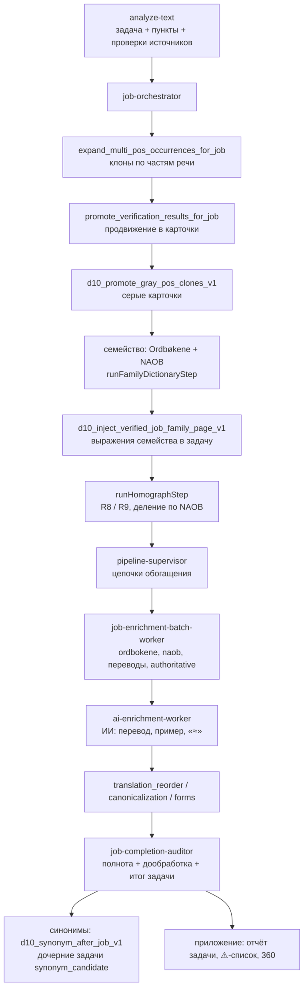

# Матрица анализа текста (D10)

Снимок того, как устроен анализ слова / текста в NorskTrainer: этапы, код, таблицы, журналы и кэши,
правила, история изменений и причины. Цель — ответить на любой вопрос по анализу, не перечитывая весь код,
и сразу видеть, где искать.

Образец по стилю — `grammar-evidence/` (матрица грамматики).

## Как читать

1. **Вид сверху** — схема ниже и таблица «вопрос → куда смотреть».
2. **`matrix.csv`** — индекс: одна строка = один элемент (функция, таблица, журнал, кэш, cron, правило).
   Колонка `audit_rewrite` отвечает на вопрос «пересчитается ли это при повторном анализе (Аудите)».
3. **`stages/NN-*.md`** — подробно по этапу, всегда по одному шаблону (`stages/_TEMPLATE.md`).
4. **`RULES.md`** — правила с номерами (взаимодействие, запросы, предметные).
5. **`CHANGELOG.md`** — что менялось: было → стало → почему → файл/миграция → коммит → результат.
6. **`decisions/`** — решения с причинами (почему так, какие варианты отвергли).
7. **`HANDOFF.md`** — текущее состояние: открытые вопросы, что в работе, следующий шаг.
8. **`sessions/`** — сводки чатов.
9. **`db-live/`** — живые тексты SQL-функций, которых нет в миграциях (создавались прямо в базе).

### Пометки достоверности

- **[проверено]** — подтверждено кодом и/или данными, указан источник.
- **[проверить по коду]** — известно по косвенным признакам или не читалось; указано, где смотреть.
- **[живой текст]** — функция существует только в базе, текст брать через `pg_get_functiondef`.

## Схема конвейера

## Вопрос → куда смотреть

| Вопрос | Этапы / файлы |
|---|---|
| Почему у слова нет перевода / примера | 09-ai-enrichment, 10-completion, 13-reports, `matrix.csv` (audit_rewrite) |
| Почему у слова неправильный перевод | 09-ai-enrichment (контекст статьи, see_also, омонимы), 07-homographs |
| Почему задача «нужна ручная проверка» | 10-completion, `RULES.md` D-коды решений |
| Почему не появилась карточка части речи | 02-pos-clones, 04-gray-cards |
| Почему у омонимов перемешано семейство 360 | 06-family-naob, 12-family-360, 07-homographs |
| Почему повторный анализ ничего не поменял | `matrix.csv` колонка `audit_rewrite`, HANDOFF раздел «разрывы перезаписи» |
| Что грузит базу | 14-background, запросы 452 / 454 |
| Что менялось и почему | CHANGELOG.md, decisions/ |

## Правило поддержки

Любое изменение конвейера считается законченным только после обновления:
строки в `matrix.csv`, файла этапа (раздел «История») и записи в `CHANGELOG.md`.
